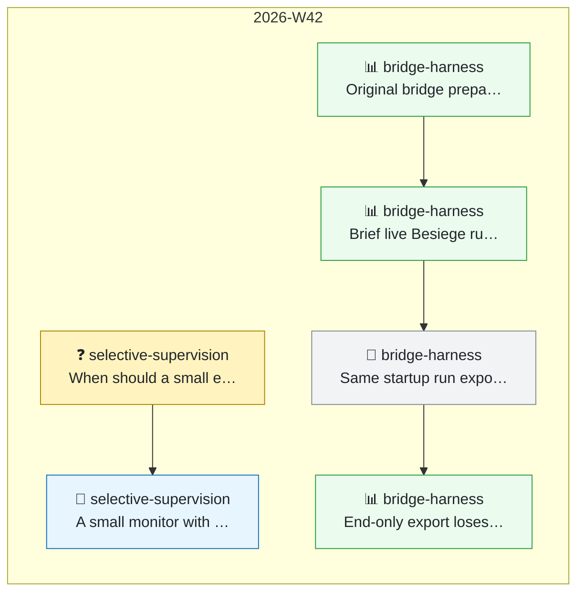

# 🧭 TIMELINE · 研发主线

> 本文件回答三个问题：**主线现在走到哪、怎么走到这里的、有没有在绕圈子。**
> 唯一写入口是 `python3 tools/timeline.py add`（AGENTS.md § 12），图由脚本生成，节点表只增不改。

- **当前主线一句话**：（Agent 每次追加 decision / pivot 节点后同步这一行）

---

## 1. 主线图（自动生成 · 勿手改）

<!-- TIMELINE:GRAPH:BEGIN -->

<!-- TIMELINE:GRAPH:END -->

**读法**：每个方框是一个 ISO 周，从左到右就是研发进度；粗箭头 `==>` 只连
`decision` / `pivot`——**它就是主线**，长时间不长一节 = 没有推进出结论；
细箭头是同一主题内的推进；虚线「重开」是已拍板的问题又被打开（绕圈的典型信号）。

---

## 2. 节点表（append-only）

<!-- TIMELINE:TABLE:BEGIN -->
| 节点 | 日期 | 类型 | 主题键 | 一句话 | 关联 | 上游 |
|---|---|---|---|---|---|---|
| `T-2026W42-001` | 2026-10-13 | question | selective-supervision | When should a small evidence-grounded monitor intervene in bridge repair by a stronger designer? | `DISC-2026W42-001` | - |
| `T-2026W42-002` | 2026-10-13 | hypothesis | selective-supervision | A small monitor with evidence checks and selective intervention can improve bridge recovery at matched inference cost; this remains untested. | `DISC-2026W42-001` | - |
| `T-2026W42-003` | 2026-10-13 | experiment | bridge-harness | Original bridge preparation/scoring validated offline: 11 tests pass; live simulation still untested. | `EXP-2026W42-001`, `DISC-2026W42-001` | - |
| `T-2026W42-004` | 2026-10-13 | experiment | bridge-harness | Brief live Besiege run produces ballast position/mass logs; complete trace export and scoring remain unverified. | `EXP-2026W42-002` | - |
| `T-2026W42-005` | 2026-10-13 | note | bridge-harness | Same startup run exported and scored: 113 telemetry pairs over 4.52 s; legacy score fails; full 17 s run pending. | `EXP-2026W42-002` | - |
| `T-2026W42-006` | 2026-10-13 | experiment | bridge-harness | End-only export loses first 13.60 s despite target load; overlapping recorder added, 17 tests pass; live capture pending. | `EXP-2026W42-003` | - |
<!-- TIMELINE:TABLE:END -->

---

## 3. 怎么写

```bash
python3 tools/timeline.py add --kind question --topic lr-schedule "学习率是不是瓶颈"
python3 tools/timeline.py check      # 绕圈检测
```

- **节点 ID**：`T-<年><周>-<序号>`（例：`T-2026W10-001`），由脚本按周分配。
- **类型**：`question` 提问 / `hypothesis` 假设 / `experiment` 改变判断的实验 /
  `decision` 拍板 / `pivot` 方向转弯 / `blocker` 卡住升级 / `note` 事后补充。
- **主题键 (topic)**：绕圈检测的钥匙——**同一件事必须共用同一个 topic**
  （例：`lr-schedule`、`pgd-robustness`）。短、稳定、可复用。
- **关联**：`EXP-...` / `DISC-...`（例：`DISC-2026W10-001`），逗号分隔；没有写 `-`。
- **上游**：父节点 ID（例：`T-2026W10-001`）；留 `-` 时自动接到同 topic 的上一个节点。
